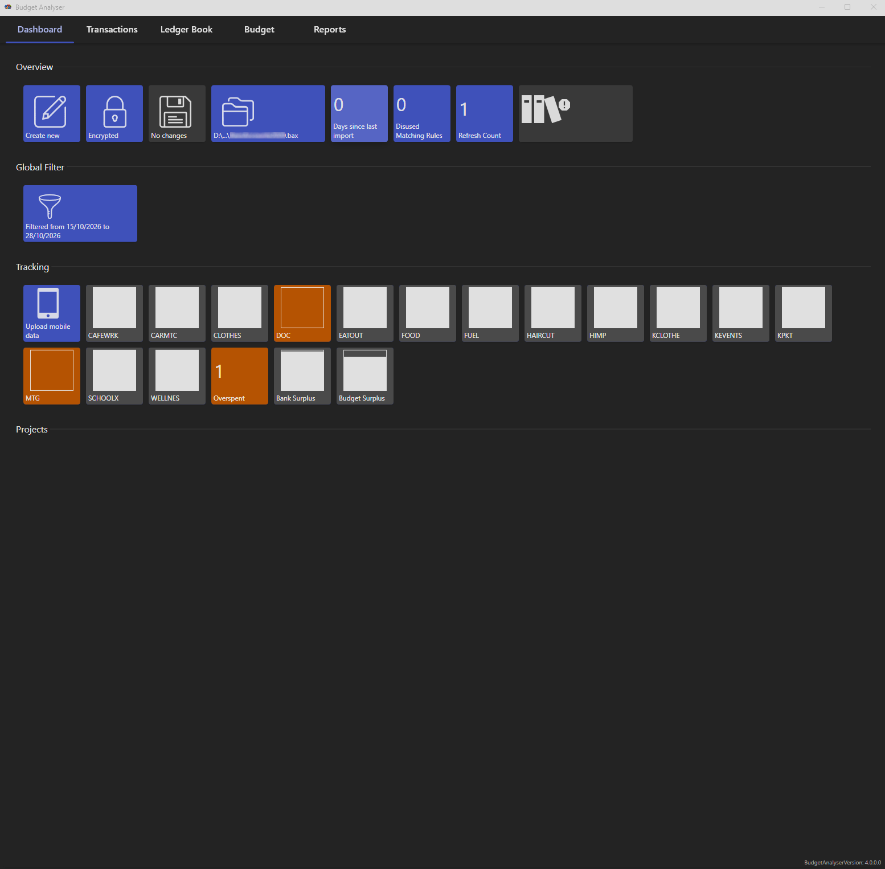
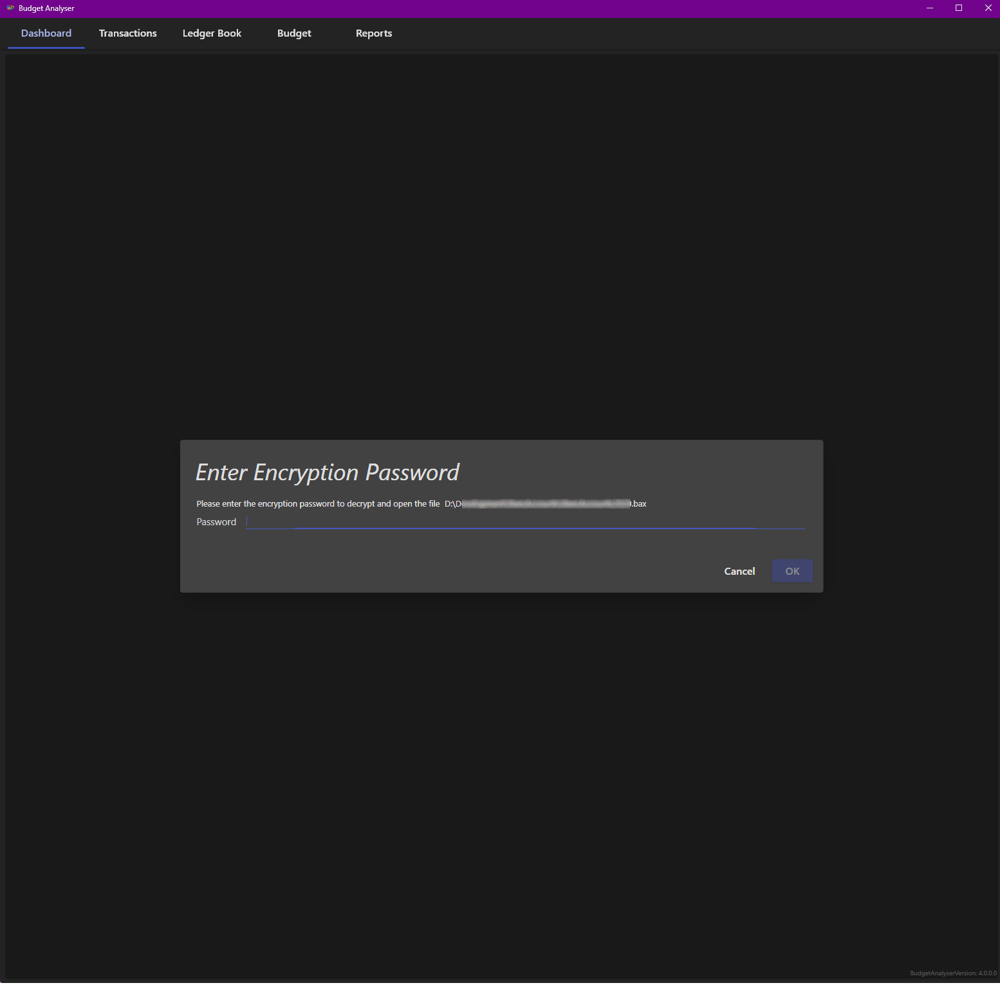
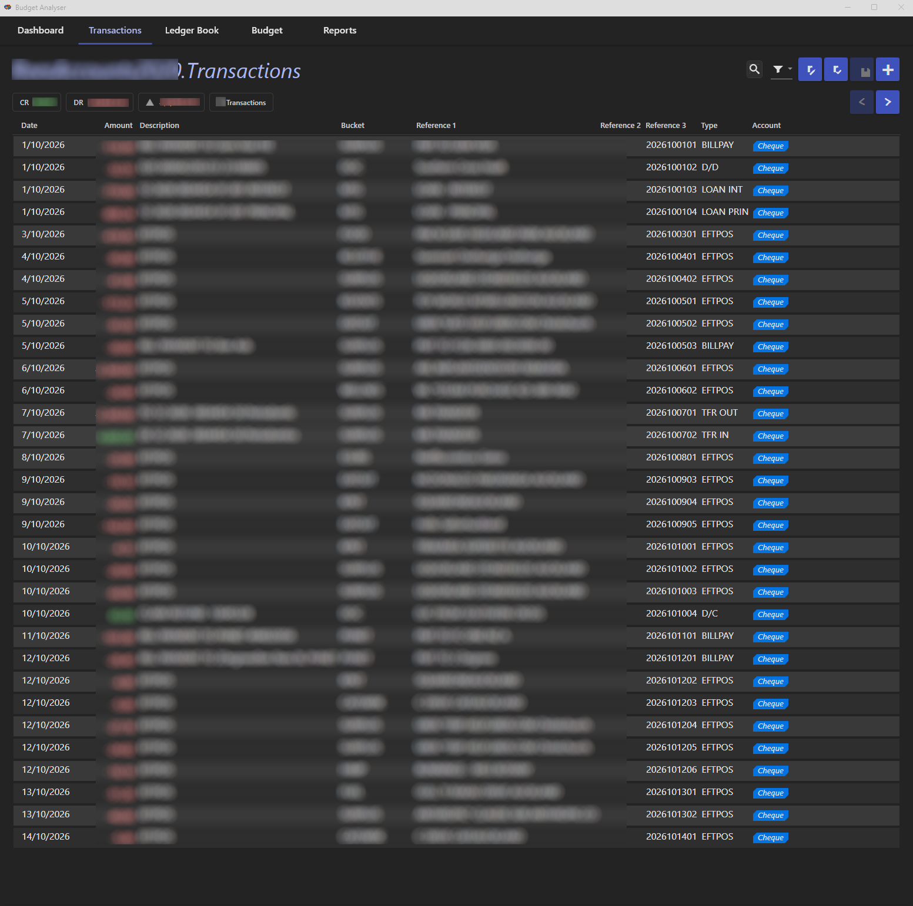
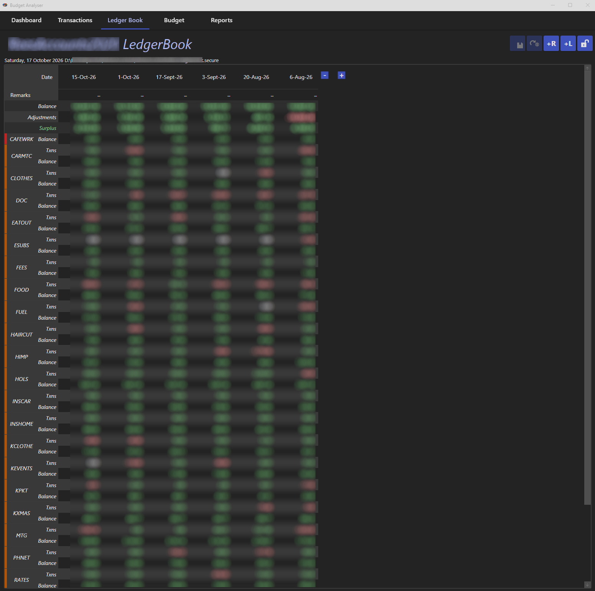
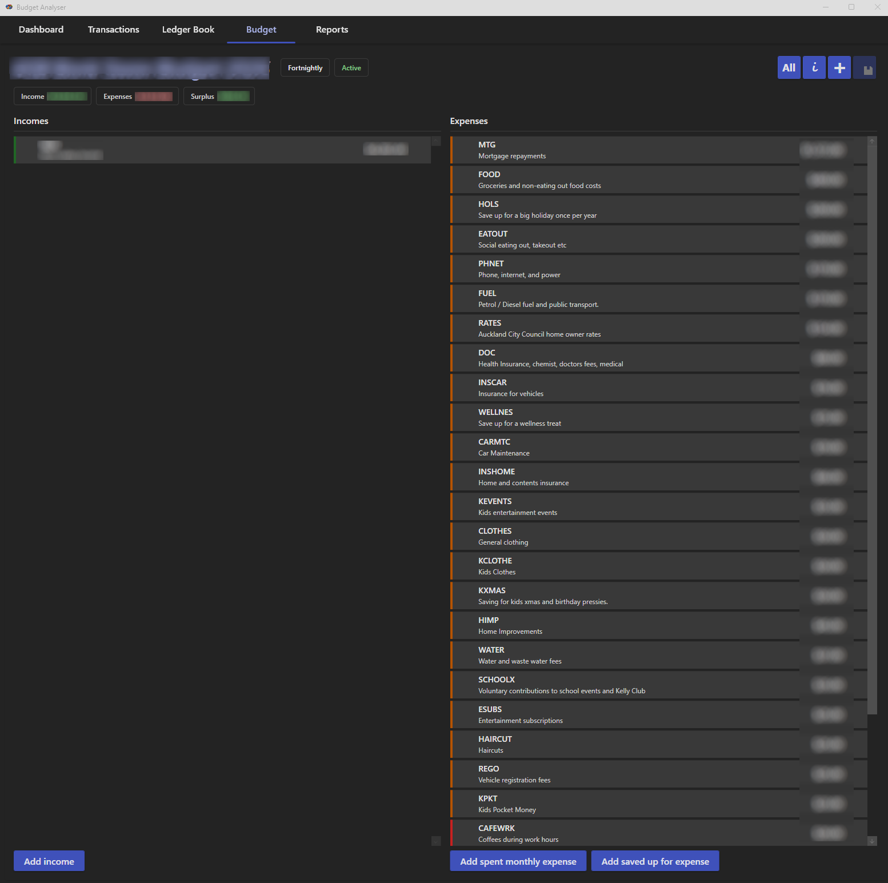

## Budget Analyser ##



What is it?
-----------
It's a simple, low time investment budgeting app. It helps you keep to a monthly or fortnightly budget, see how much you can spend during the period and analyse past data to improve your budget.

Why?
----
Some budgeting apps are complicated or time consuming and aren't very visual. I wanted something that I can spend minutes with per month and to store data in a neutral manner. This code is open
source, so if it doesn't exactly suit your budgeting style, then fork it, and change it.

Features
--------

- Automatically match transactions with budget categories aka "Buckets".
- Import bank transactions in CSV format and only store them locally; ie not uploaded anywhere.
- Specify a monthly or fortnightly budget and monitor how you track against imported transactions.
- Reconcile your bank accounts against your budget each period using the Ledger Book.
- Visual graphs for tracking performance.
- Analyse any period of time to find averages and improve your budget.
- Plan for long term goals and ad-hoc/annual bills with "saved-up-for" budget categories.
- Figure out how much surplus you have with actual bank transaction data while still ensuring you don't spend money set aside for longer term goals/bills.
- Optional password based encryption of all saved data files.
- A dark, Material Design inspired user interface.

Overview
--------
It's a simple 2 tier application with all business logic residing in the engine assembly (`BudgetAnalyser.Engine`). The UI is a WPF desktop application (`BudgetAnalyser`) styled with
[MaterialDesignInXamlToolkit](https://github.com/MaterialDesignInXAML/MaterialDesignInXamlToolkit) using a dark theme. All data is saved only locally, no data is uploaded anywhere. This project has a
fundamental goal not to upload any user's personal budgeting or bank transaction data online to protect privacy by removing the risk.
No databases are used, data is saved in JSON format. A Budget Analyser file (`*.bax`) ties together the budget, ledger book, transactions and matching rules files that make up your data set.

Security
--------
This application does not upload any information provided to the Internet. All provided data is saved locally to disk. Data files can optionally be encrypted with a password (see the Encrypt tile on
the Dashboard). When a file is encrypted you will be prompted for the password when it is opened:



The password is held in memory only for the duration of the session and is never saved to disk. If you forget it, your data cannot be recovered. If encryption is not used, the user is responsible for
securing the locally saved file data, if necessary.

This application is intentionally written as a client-side only Windows application for maximum security. Because no information is shared, no information can be leaked. Optionally the user can use a
companion mobile app, and to support this summarised data must be uploaded to an S3 bucket. This summarised data does not contain any personal, income or transactional information. Using the mobile app
is optional, and if not used, no data is uploaded to the cloud.

Getting Started
---------------
No binaries are currently uploaded, so you will need to build the solution yourself.

**Requirements:**

* .NET 10.0 SDK
* Windows OS (due to WPF dependency)

**Build and run:**

```
dotnet build BudgetAnalyser.sln
dotnet run --project BudgetAnalyser/BudgetAnalyser.Wpf.csproj
```

On the Dashboard use the _Load Demo_ tile to explore the app with sample data, or _Create New_ to start your own.

**Solution structure:**

* `BudgetAnalyser.Engine` - all business logic, persistence and services. No UI dependencies.
* `BudgetAnalyser.Encryption` - optional file encryption for saved data.
* `BudgetAnalyser` - the WPF user interface.
* `Rees.Wpf` - shared WPF helpers (converters, behaviours, base controller classes).
* `BudgetAnalyser.Engine.XUnit3`, `BudgetAnalyser.Wpf.XUnit3` - unit tests.
* `BudgetAnalyser.InstallTest` - an end to end clean install test. It clones the repo into an empty temp folder, builds, runs the unit tests, launches the app, closes it
  with the window's close button and checks it exits with code 0. It is slow and needs network access so it is skipped unless enabled:
  `$env:BUDGETANALYSER_INSTALL_TEST=1; dotnet test BudgetAnalyser.InstallTest`. Set `BUDGETANALYSER_INSTALL_TEST_REPO` and `BUDGETANALYSER_INSTALL_TEST_BRANCH` to test a
  different fork or branch (defaults to `master` on GitHub).

All package dependencies are available on Nuget.org.

Terminology
-----------

* _Bucket_

A Bucket is a metaphor used to describe a container that contains a set amount of funds ready to be spent. When the bucket is empty, there is no more money to spend. Buckets cannot have an overdrawn (
negative) balance. Any overspending is automatically taken from the Surplus bucket, if there's no Surplus remaining, get ready to bounce.
There are a few different kinds of buckets: A Spent-Periodically-Bucket (spent monthly or fortnightly) is a bucket that will automatically empty any remaining funds into Surplus at the end of the
period, if all funds are not spent. A Saved-Up-For-Bucket will not empty itself at the end of the period, so if all funds are not spent the bucket will get bigger over time. This is useful for
expenses that are paid annually or ad-hoc, ie not paid on a regular date each period.
When setting up a Budget you create Buckets and set an amount per period you wish to allocate from your income.

* _Ledger Book_

The Ledger Book is where you reconcile your bank account(s) against your budget at the start of each budget period. Each reconciliation records the bank balance, the opening balance of every bucket
and any adjustments. It is the source of truth for how much money is actually available in each bucket.

* _Matching Rules_

Rules that automatically assign imported bank transactions to a bucket, based on the transaction's description, references and amount.

The Dashboard
-------------
The dashboard (shown at the top of this page) is used to show quick reference information and alerts. Most functionality on this page is only available when the global filter is set to show one
budget period's worth of data.

Overview Tiles

* _Create New, Open, Load Demo, Save Tiles_

These tiles provide the ability to create, load and save Budget Analyser files. The current file tile shows the file that is currently open.

* _Encrypt Tile_

Shows whether the current file is encrypted or unprotected, and allows encryption to be turned on or off.

* _Days Since Last Import Tile_

Shows the number of days since bank transaction data was loaded into the analyser.

* _Disused Matching Rules Tile_

Shows the number of matching rules that have not been used for more than a year, so they can be tidied up.

* _Overspent Tile_

Shows the number of buckets that have been overspent this period.

* _Surprise Payment Warning Tile_

This is a configurable tile that can monitor a single bucket that has weekly or fortnightly payments. Sometimes there will be three fortnightly payments or five weekly payments in one month. This tile
will warn when the next "surprise" payment will be.

Global Filter Tiles

* _Date Filter Tile_

Provides a date range filter. This should usually be set to one budget period's worth of data, except when running reports looking for trends over long periods. This filter controls all date range
filtering throughout the application, including reporting.

Tracking

* _Upload Mobile Data Tile_

Uploads summarised data for the optional companion mobile app (see Security above).

* _Bucket Monitoring Tiles_

These are configurable tiles that can be optionally added per bucket. They show a bar graph indicating remaining funds left in the bucket for the period. A tile turns orange when the bucket is
overspent.

* _Bank Surplus_

This is a bar graph showing the remaining funds left in the Surplus bucket. This monitors the actual bank Surplus amount from the previous Ledger Book Reconciliation. Essentially this is the remaining
funds available for general spending (ie spending that doesn't fall into any other Budgeted Bucket category).

* _Budget Surplus_

This is a bar graph showing the remaining funds for Surplus compared to the budgeted surplus amount. This is sometimes different to the real surplus funds in the bank when incomes exceed expected
budget amounts, or other budget buckets have exceeded their budgeted amounts. For comparison purposes only.

Projects

* _Fixed Amount Project Tiles_

These are configurable tiles where you have an on-going project that you do not want to spend more than a certain amount on. For example a renovation project to repaint and decorate a bedroom. The bar
graph shows how much of the project's budget remains.

Transactions
------------


The Transactions screen lists all imported bank transactions within the global date filter. Summary chips show the total credits, debits and net amount for the filtered transactions. From here you can
import new bank statements (CSV), search and filter transactions, edit transactions and assign them to buckets, and create matching rules so future transactions are assigned automatically.

Ledger Book
-----------


The Ledger Book shows each reconciliation as a column, most recent first, with a row for every bucket's transactions and balance. Amounts are coloured green or red by sign. Use the toolbar to add a new
reconciliation (+R) at the start of each budget period, add a new bucket ledger to track (+L), or unlock the most recent reconciliation to add transactions to it.

Budget
------


The Budget screen is where you define your incomes and expenses for each budget period (monthly or fortnightly). Each expense is a bucket, either a "spent periodically" bucket or a "saved up for"
bucket. Summary chips show the total income, expenses and resulting surplus. Multiple budgets can be kept over time, with the one effective for the current date shown as Active.

Reports
-------
The Reports screen provides graphs and analysis over any period of time selected by the global date filter, such as long term spending trends per bucket, to help you refine your budget.

Useful Commandlines to remember
-------------------------------
`dotnet build -t:Metrics`
This will update the metrics xml files for each project. Useful to keep track of the size, complexity, and maintainability index of the code.
